<p align="center">
  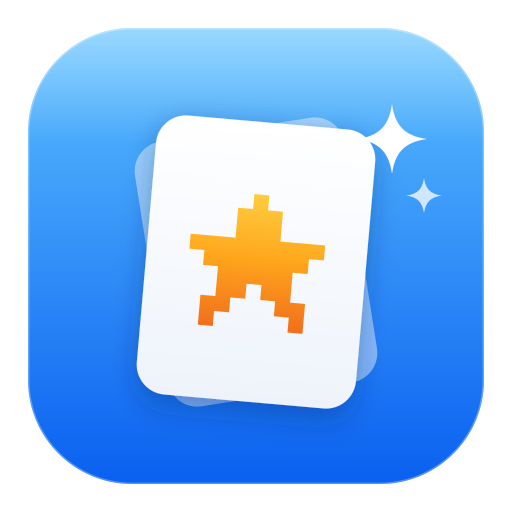
</p>

<h1 align="center">Anki macOS Native</h1>

<p align="center">
  <b>Make Anki feel like it shipped with macOS 26, and ask Claude, ChatGPT, Gemini or a local model about any card without leaving your review.</b>
</p>

<p align="center">
  <a href="https://github.com/dabarov/anki-macos-native/releases/latest/download/macos_native_anki.ankiaddon"></a>
  
  
  <a href="LICENSE"></a>
</p>

<p align="center">
  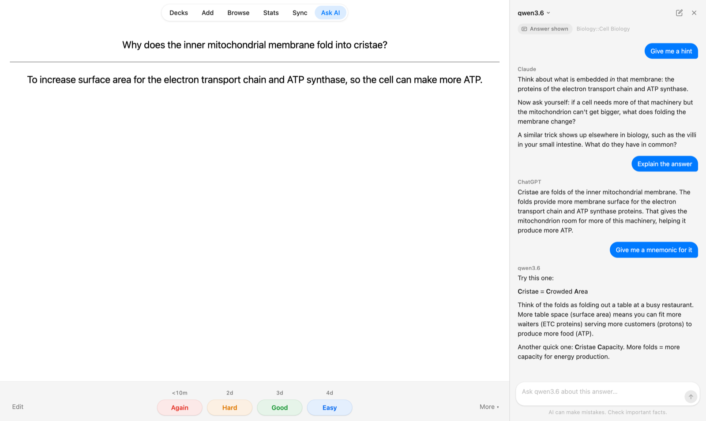
</p>

## Before and after

| Stock Anki | With Anki macOS Native |
| --- | --- |
| 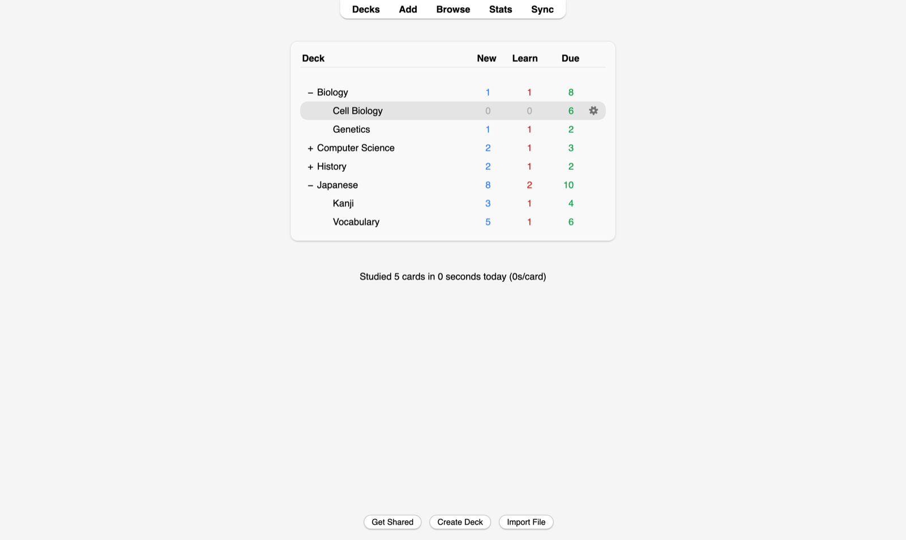 | 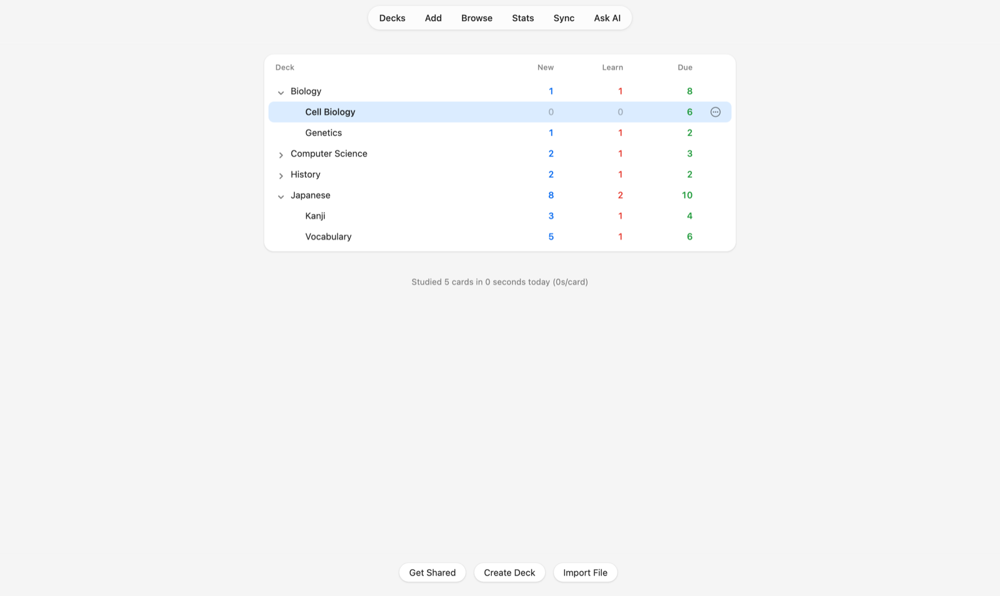 |
| 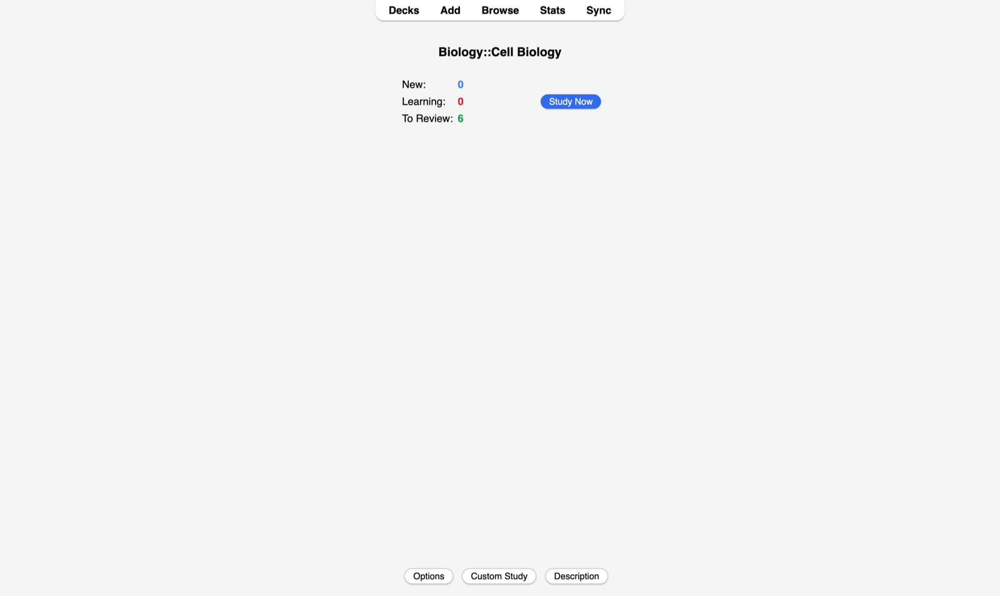 | 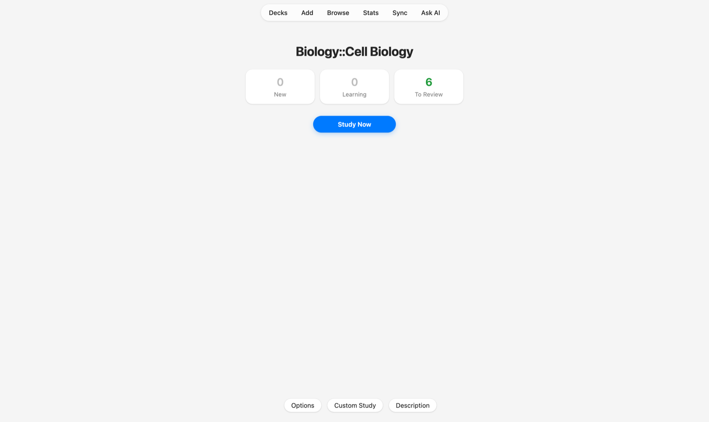 |
| 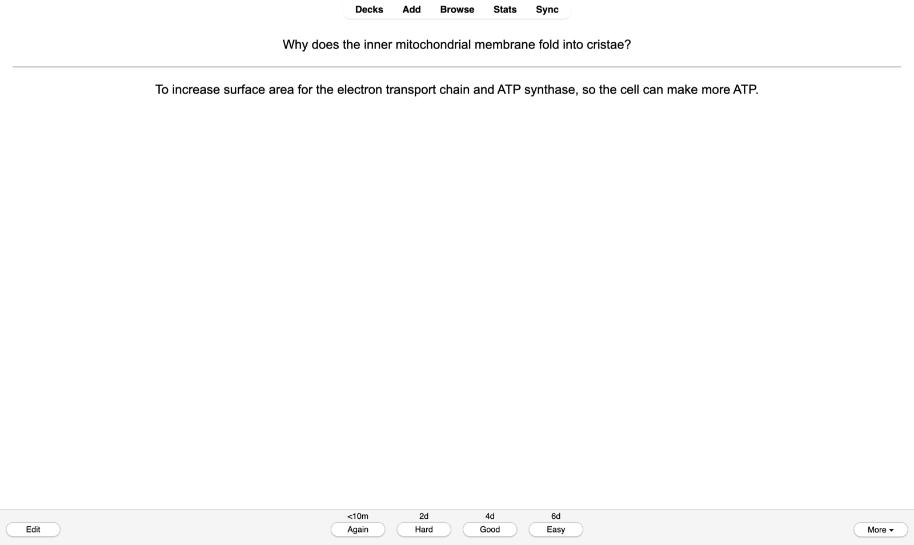 | 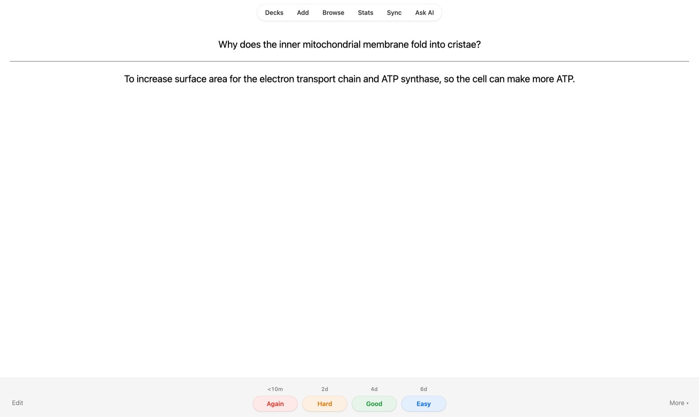 |

## What you get

### A main window that looks like a Mac app

- **San Francisco everywhere**, on the macOS type scale, with tracking set per size. Cards that still use Anki's stock Arial are shown in SF as well. Your note types are never edited, and cards with a font you picked keep it.
- **Your accent colour** from System Settings → Appearance, in light and dark mode.
- **A floating glass toolbar** in place of the flat strip of links.
- **An inset, grouped deck list** with rounded row highlights, chevrons for subdecks, an accent tint on the current deck, tabular counts and a "⋯" options button that appears on hover.
- **A deck overview** with a large title, count tiles and one clear Study Now button.
- **A calmer review bar.** Show Answer is the default button. Again / Hard / Good / Easy are tinted capsules, so colour tells them apart without four solid fills competing.
- **Menus and the deck Options screen match too.** Pop-up menus get rounded corners, an inset accent highlight and inset separators. Deck Options gets grouped sections, a segmented Preset / This deck / Today only control and macOS-style switches.
- **Motion that feels physical.** Buttons press in the moment you click and spring back on release. Screens settle in with a critically damped spring, only when you change screens.
- **Accessibility built in.** Reduce Motion (macOS or Anki) swaps motion for a short fade. Reduce Transparency turns glass solid. Increase Contrast strengthens edges and secondary text. VoiceOver labels the deck disclosure buttons.

<p align="center">
  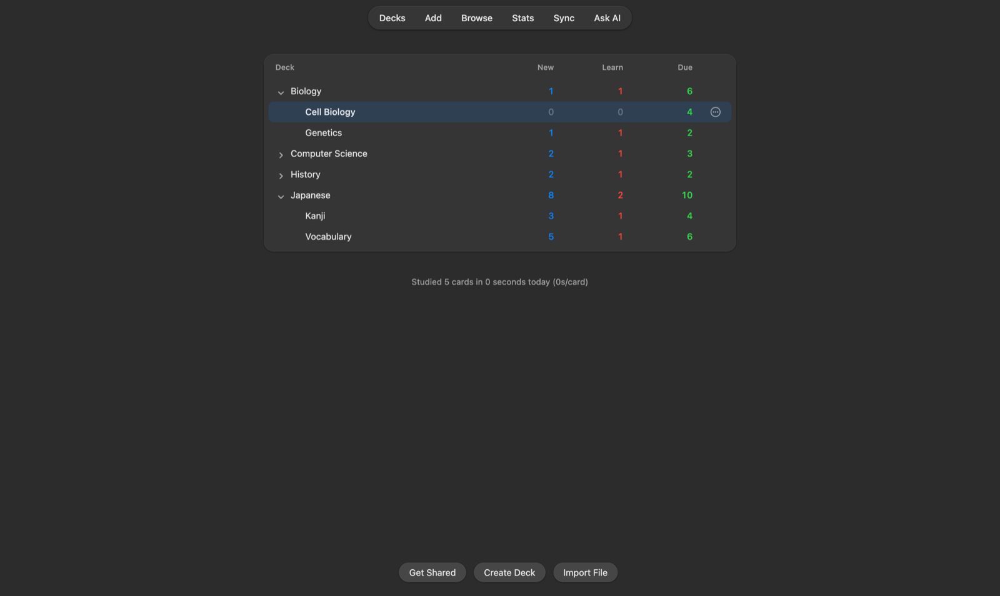
</p>

| Deck Options | In dark mode |
| --- | --- |
| 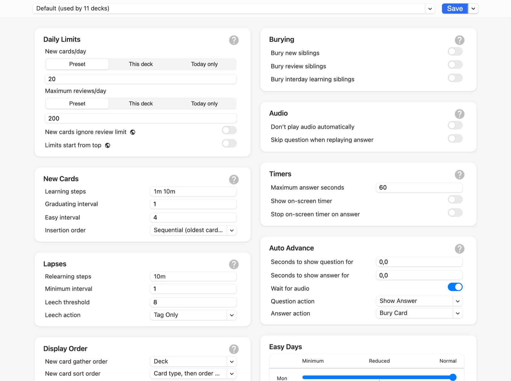 | 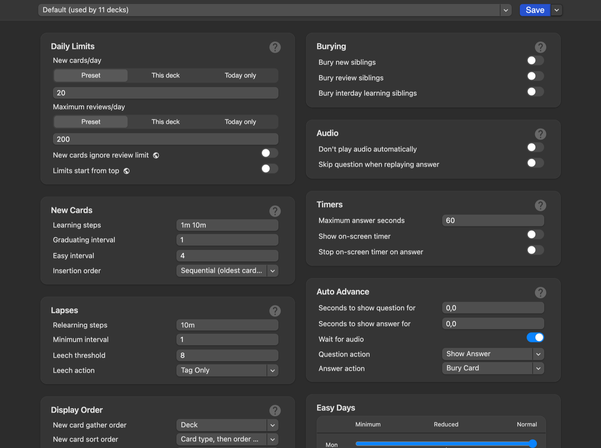 |

### Ask AI, right next to the card

<p align="center">
  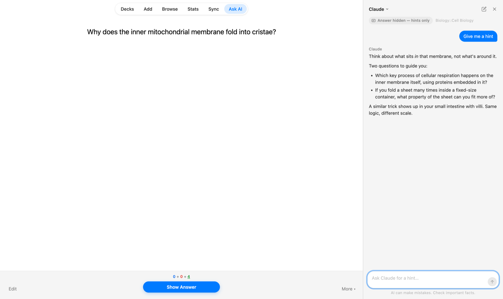
</p>

Stuck on a card? Open the panel with **Ask AI** in the toolbar, Tools → Ask AI, or **⌥⌘I**, and ask.

- **Pick your model** from the panel's title: Claude, ChatGPT, Gemini, or any model in Ollama, local or cloud. Everything answers through apps already on your Mac, so no API keys are stored in Anki.
- **Compare answers.** A card's conversation is shared across models, and each reply is labelled with the model that wrote it, so you can switch mid-thread.
- **No spoilers.** While the answer is hidden, the model sees only the question and gives hints. Once you reveal the answer, it explains it, gives examples or helps you remember it.
- **One conversation per card.** The next card starts fresh, and stepping out to the deck list and back keeps the conversation.
- **Typing is safe.** While the message field has focus, Anki's single-key review shortcuts (Space, Enter, 1–4, E, R, …) are paused, so typing "1" can't answer a card.

<p align="center">
  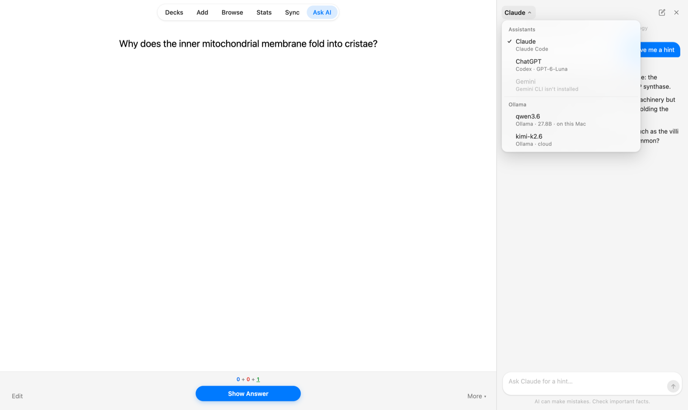
</p>

<p align="center">
  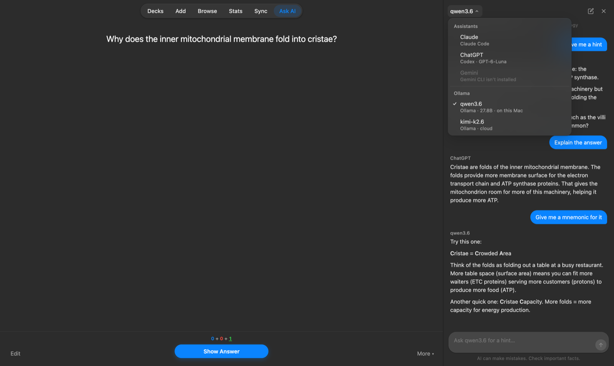
</p>

## Install

1. Download **[macos_native_anki.ankiaddon](https://github.com/dabarov/anki-macos-native/releases/latest/download/macos_native_anki.ankiaddon)** from the latest release.
2. Double-click it. Anki opens and installs it. Or use Tools → Add-ons → Install from file….
3. Restart Anki.

To **update**, install the newer `.ankiaddon` the same way; your settings are kept. To **turn it off**, use Tools → Add-ons → macOS Native → Toggle Enabled.

### Setting up Ask AI

Set up whichever models you want. The picker greys out the ones it can't find and says why.

| Model | What you need |
| --- | --- |
| **Claude** | [Claude Code](https://claude.com/claude-code). Run `claude` in Terminal once and sign in. |
| **ChatGPT** | The [ChatGPT app](https://openai.com/chatgpt/download/), signed in. It includes the Codex CLI the panel uses. A standalone `codex` install works too. |
| **Gemini** | [Gemini CLI](https://github.com/google-gemini/gemini-cli). Run `gemini` once and sign in. |
| **Ollama** | [Ollama](https://ollama.com) with at least one model (`ollama pull qwen3`). If Ollama isn't running, the picker offers to start it. |

## Privacy

The panel sends the model you picked the deck name, the card's question, the answer (only once you've revealed it) and the conversation for that card. Nothing is sent until you ask a question.

- **Claude Code** runs with its tools, MCP servers, skills and settings files switched off.
- **Codex** runs in a read-only sandbox in an empty folder, with no saved session.
- **Ollama** models on your Mac never leave it. Cloud models go to Ollama's servers.

## Configuration

Tools → Add-ons → macOS Native → Config. Restart Anki after changing a setting.

| Key | Default | What it does |
| --- | --- | --- |
| `accent` | `"system"` | Follows the macOS accent colour, or set a hex colour such as `"#5E5CE6"`. |
| `motion` | `true` | `false` turns off entrance motion. |
| `card_font` | `"system"` | Shows stock-Arial cards in SF. `"template"` shows exactly what the card's CSS says. |
| `claude_model` | `""` | Claude model. Empty uses Claude Code's default. |
| `codex_model` | `""` | ChatGPT model. Empty uses the first model Codex lists for your account. |
| `gemini_model` | `""` | Gemini model. Empty uses the Gemini CLI default. |
| `ollama_url` | `"http://127.0.0.1:11434"` | Where Ollama is listening. |
| `claude_path`, `codex_path`, `gemini_path` | `""` | Paths to each CLI, if they aren't found automatically. |

## Compatibility

Built and tested with **Anki 26.09** on **macOS 26 Tahoe**. The add-on only adds styles and a panel on top of Anki's own pages, and it never touches Anki's files or your collection's note types.

## Development

```bash
git clone https://github.com/dabarov/anki-macos-native.git
cd anki-macos-native
./scripts/install-dev.sh       # links the repo into Anki's add-ons folder
./scripts/build.sh             # builds dist/macos_native_anki.ankiaddon
./scripts/release.sh minor     # bump, tag, build, push and publish a GitHub release
```

`release.sh` takes `patch` (default), `minor`, `major` or an exact version, and `--dry-run` to preview the version and release notes without changing anything. Notes are grouped from [conventional commits](https://www.conventionalcommits.org) since the last tag.

| File | Purpose |
| --- | --- |
| `__init__.py` | Adds the theme to Anki's main-window pages, reads the accent colour, swaps stock Arial on cards |
| `web/macos.css`, `web/macos.js` | The theme. Every rule is scoped to `:root[data-mn="<screen>"]` |
| `web/pages.css` | Anki's Svelte pages (deck Options, Card Info, …), styled through their Bootstrap classes |
| `qt_style.py` | Pop-up menu styling, with rounded corners on menus Anki opens |
| `ai_panel.py` | The Ask AI dock: card context, per-card conversation, model choice, shortcut pausing |
| `providers.py` | Finds and runs each model: Codex, Gemini CLI, Ollama |
| `claude_cli.py` | Streams one reply from Claude Code with tools off |
| `web/ai-panel.css`, `web/ai-panel.js` | The panel UI and model picker, using the same design tokens as the theme |
| `snapshot.py`, `audit.py` | Dev tools: `ANKI_MN_SNAPSHOT=<dir>` saves each screen as PNG; `ANKI_MN_AUDIT=<dir>` writes the computed fonts of every screen |

## Credits

Design guidance from Emil Kowalski's [apple-design](https://github.com/emilkowalski/skills/tree/main/skills/apple-design) skill and Apple's WWDC design talks.

Not affiliated with Anki, Apple, Anthropic, OpenAI, Google or Ollama.

## License

[MIT](LICENSE)
